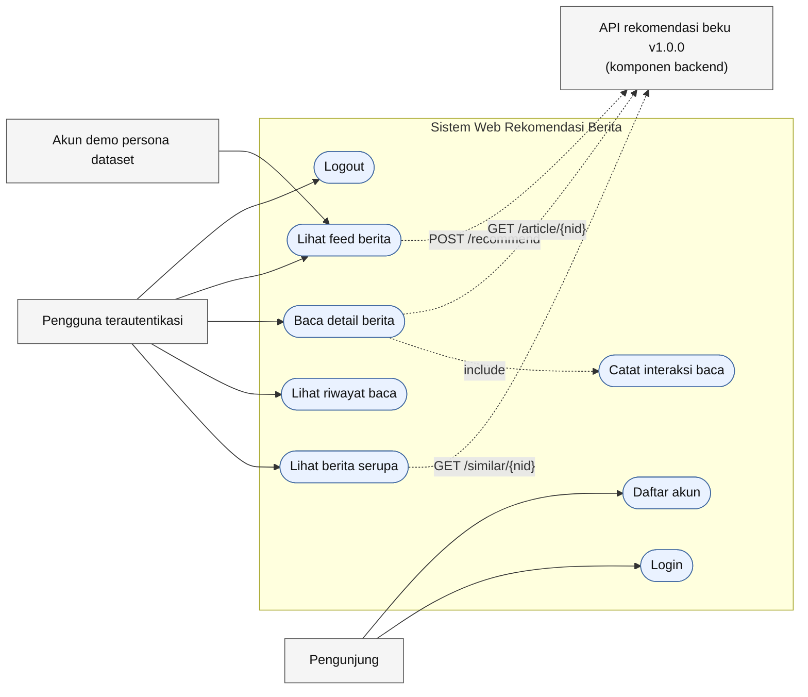
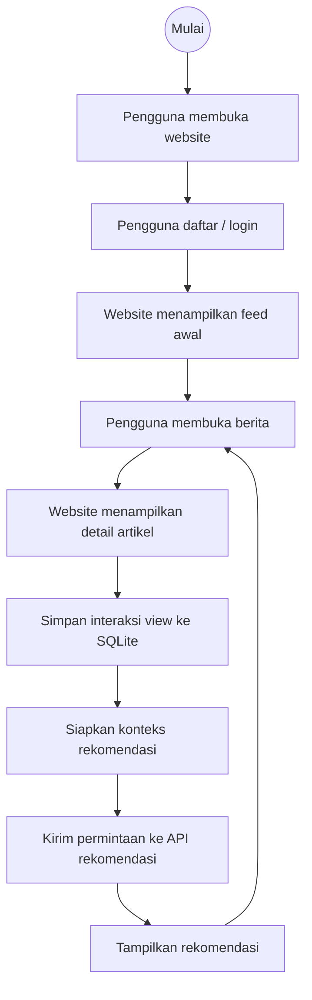
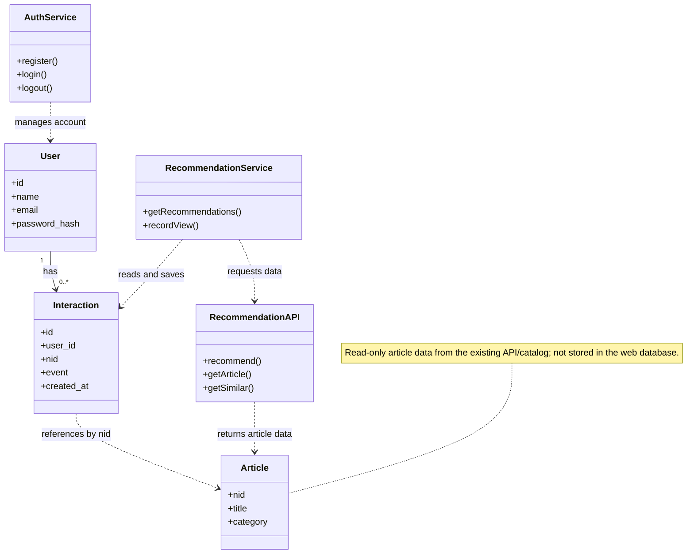
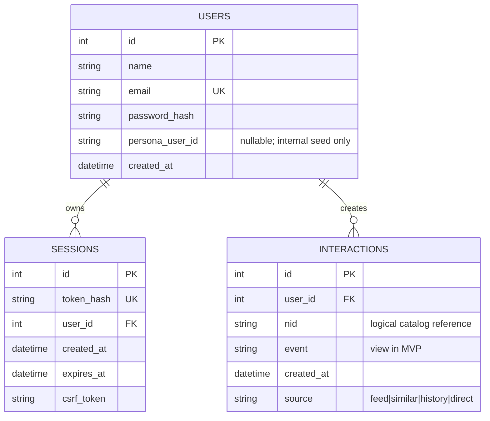

# Diagram Desain Awal — Web Sistem Rekomendasi Berita

Status: **usulan desain untuk direview sebelum implementasi agent**.

## Keputusan desain yang dipakai

1. Akun aplikasi (`users.id`) berbeda dari ID pengguna dataset MIND (`persona_user_id`).
2. Akun biasa mendapatkan feed awal dari berita populer (frekuensi klik pada data train, bukan output model). Setelah membaca, aplikasi menyimpan `nid` sebagai interaksi dan mengirim riwayat itu ke `POST /recommend` pada permintaan berikutnya.
3. Akun demo persona yang di-seed secara internal memakai jalur warm dengan `user_id` dataset. Untuk akun ini, profil dataset yang dipakai API; riwayat aplikasi tetap dicatat, tetapi tidak dicampur ke payload warm.
4. Pemilihan topik tidak menjadi langkah wajib MVP. Rekomendasi pengguna biasa sudah dapat berawal dari riwayat baca; onboarding topik bisa ditambahkan nanti setelah mapping ke katalog didefinisikan dan diuji.
5. Web tidak melatih ulang model, mengubah artefak, menulis ke Parquet, mengubah alpha=0.4, atau mengubah kontrak API v1.0.0.
6. Artikel dibaca dari katalog/API, bukan tabel artikel lokal. `interactions.nid` adalah referensi logis yang divalidasi aplikasi, bukan foreign key SQL.
7. MVP hanya mencatat event `view`. Rating, pencarian, profil preferensi, dan fitur admin tidak masuk diagram inti.
8. Feed rekomendasi: request `top_k=30`, filter semua `nid` yang pernah dibaca, deduplikasi berdasarkan `nid`, lalu tampilkan maksimal 10 dengan urutan hasil API yang tetap.
9. Jika akun persona warm mendapat 404 karena mapping tidak valid, coba jalur history jika ada; jangan tampilkan error mentah ke pengguna.

## 1. Use Case Diagram

Untuk notasi UML yang lebih formal, gunakan diagram Mermaid di atas sebagai
sumber; tidak ada berkas PlantUML/ZIP terpisah dalam repositori ini.

## 2. Activity Diagram — Versi Sederhana

Diagram ini sengaja dibuat satu alur tanpa percabangan keputusan. Perbedaan antara akun biasa dan akun persona MIND dirangkum di dalam langkah sistem agar diagram lebih mudah dibaca.

**Keterangan langkah sistem:**
- Feed pertama akun biasa yang belum punya riwayat menggunakan berita populer dari statistik klik data train.
- Akun demo persona menggunakan `user_id` dari dataset MIND untuk rekomendasi *warm*.
- Saat pengguna membuka artikel, sistem menyimpan event `view` ke SQLite.
- Untuk akun biasa, konteks rekomendasi berikutnya berasal dari `nid` dalam riwayat baca. Untuk persona MIND, konteksnya tetap `user_id` dataset.
- Interaksi website yang baru tercatat tidak otomatis melatih ulang model ALS.

Alur berulang dari **Tampilkan rekomendasi** ke **Pengguna membuka berita** menunjukkan bahwa pengguna dapat terus membaca berita dan menerima rekomendasi berikutnya.

## 3. Class Diagram — Versi Sederhana

Diagram ini hanya menampilkan kelas inti: akun, interaksi baca, data artikel, layanan autentikasi, layanan rekomendasi, dan API rekomendasi yang sudah tersedia.

**Keterangan:**
- `User` menyimpan identitas akun website.
- `Interaction` menyimpan setiap kunjungan artikel (`event=view`) beserta waktu. Satu pengguna dapat memiliki banyak interaksi.
- `Article` adalah data artikel yang dibaca dari API/katalog, bukan tabel lokal website. `nid` menghubungkan catatan interaksi dengan artikel.
- `AuthService` menangani daftar, login, dan logout.
- `RecommendationService` membaca riwayat, mencatat kunjungan, dan meminta hasil dari `RecommendationAPI`.
- `RecommendationAPI` adalah layanan yang telah ada; diagram ini tidak menyatakan bahwa model rekomendasinya dibuat ulang oleh website.

## 4. ERD

## Batas data dan implementasi

- SQLite hanya menyimpan `users`, `sessions`, dan `interactions` untuk MVP.
- Dataset katalog, interaksi penelitian, dan seluruh artefak model tetap read-only.
- Cookie menyimpan token sesi; database hanya menyimpan `token_hash`. Password disimpan sebagai hash.
- `interactions` tidak memakai constraint unik `(user_id, nid)` karena setiap kunjungan perlu tercatat; saat menyusun payload rekomendasi, daftar `nid` dibuat unik berdasarkan kunjungan terbaru.
- Jangan menyimpan score rekomendasi: nilainya dinormalisasi per request sehingga tidak tepat dibandingkan antar-request.
