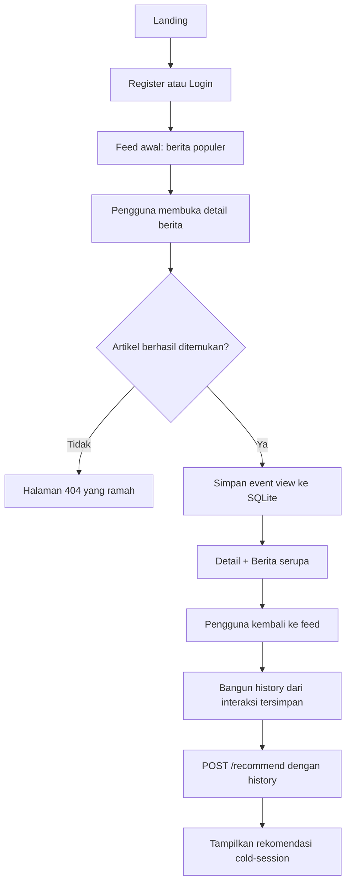
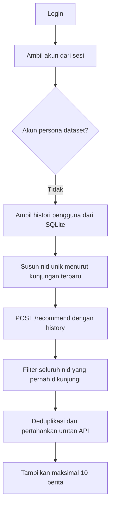
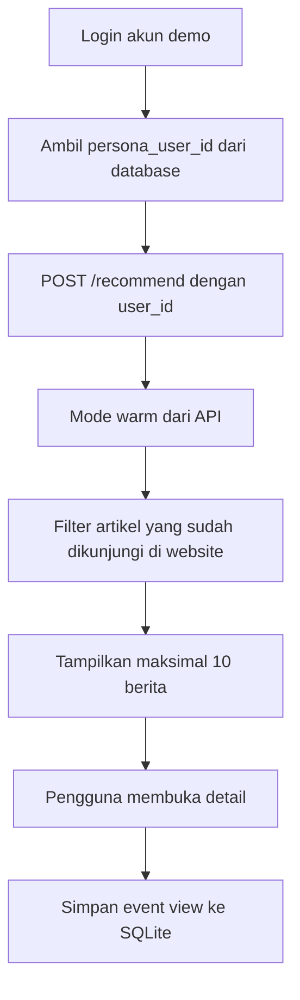

# PRD — Website Sistem Rekomendasi Berita Bahasa Indonesia

**Versi:** 1.1  
**Tanggal:** 20 Oktober 2026 · disetujui 21 Oktober 2026 · **revisi korpus 27 Oktober 2026**  
**Status:** v1.0 **disetujui dan diimplementasikan** (`src/web/`, 193 tes, `scripts/smoke_web.sh`, `scripts/audit_freeze.sh`). **Revisi v1.1 (peralihan korpus + interaksi simulasi) adalah draf yang menunggu persetujuan pembimbing**; setelah disetujui, keputusan §18 mengikat.  
**Bahasa produk:** Bahasa Indonesia  
**Tujuan:** Menjadi sumber kebenaran utama bagi coding agent saat membangun lapisan web di atas sistem rekomendasi yang sudah ada.

---

## 0. Revisi v1.1 — Peralihan Korpus dan Interaksi Simulasi (27 Oktober 2026)

Revisi ini mengganti sumber katalog dan interaksi. Perubahan strukturalnya:

1. **Katalog** berganti dari MINDsmall/xMINDsmall ke korpus portal berita Indonesia (Detik, Tempo, Kompas; Juli 2024 – Oktober 2025; 80.472 baris mentah → 67.381 artikel unik setelah deduplikasi URL). Sumber: Kaggle `sh1zuka/indonesia-news-dataset-2024`, CC BY-NC 4.0.
2. **Konsekuensi field:** katalog baru memiliki konten penuh, tanggal terbit, dan sumber (yang semuanya tidak ada di MIND), tetapi tidak memiliki abstrak/subkategori MIND. Kategori diperoleh dari pemetaan seksi URL, bukan dari tag portal.
3. **Interaksi** berganti dari log perilaku MIND ke **interaksi hasil simulasi akun dummy** yang dibangkitkan oleh pipeline penelitian, dengan lapisan `view`-saja sesuai §18.
4. **Kontrak API v1.0.0 dan nama field `nid` dipertahankan** — nilai `nid` kini adalah ID katalog baru yang ditetapkan deterministik oleh pipeline, sehingga lapisan web dan kontrak tidak berubah bentuk.
5. Semua perubahan keputusan dikonsolidasikan di §18; perubahan field UI di §10.2–10.3.

---

## 1. Ringkasan Produk

Website ini adalah antarmuka yang memungkinkan pengguna membuat akun, membaca berita berbahasa Indonesia dari katalog penelitian, menyimpan riwayat kunjungan artikel, dan menerima rekomendasi berdasarkan riwayat tersebut. Website juga menyediakan akun demo yang dipetakan ke **akun dummy hasil simulasi interaksi** pada korpus berita Indonesia agar jalur rekomendasi *warm* dapat didemonstrasikan saat sidang.

Produk terdiri dari dua bagian yang batasnya harus dijaga:

1. **Web app baru:** akun, sesi, feed, detail berita, riwayat, dan pencatatan interaksi; menggunakan SQLite.
2. **Sistem rekomendasi penelitian yang sudah ada:** API v1.0.0, model hybrid TF-IDF + ALS, artefak, dan parameter serving `alpha = 0.4`; semuanya tetap menjadi sumber rekomendasi dan tidak dilatih ulang oleh website.

### Keputusan produk paling penting

- **Tidak ada halaman “Pilih Topik” yang wajib.** Personalisasi user biasa dimulai dari perilaku membuka berita, bukan preferensi topik yang belum tentu ada pemetaannya secara valid di dataset.
- **User baru tanpa riwayat melihat berita populer** sebagai feed awal. Feed ini bukan hasil personalisasi model dan harus diberi label yang jujur.
- **Setelah detail berita berhasil dibuka, website merekam satu event `view`.** Event ini berarti artikel dikunjungi, bukan bukti bahwa seluruh artikel telah dibaca.
- **User biasa dengan riwayat memakai jalur cold-session** melalui `POST /recommend` dengan `history` berisi `nid` yang pernah dikunjungi.
- **Akun persona korpus memakai jalur warm** melalui `POST /recommend` dengan `user_id` akun dummy hasil simulasi yang telah dikonfigurasi dan diverifikasi.
- Interaksi website **tidak otomatis melatih ulang ALS** dan tidak mengubah metrik penelitian.
- **Interaksi model berasal dari simulasi akun dummy, bukan pengguna nyata.** UI dan laporan tidak boleh mengklaim bahwa personalisasi mencerminkan perilaku pembaca nyata.

## 2. Masalah yang Diselesaikan

Demo yang hanya meminta pengguna memasukkan `user_id` dataset atau menempelkan daftar `nid` cocok untuk memeriksa API, tetapi belum menunjukkan pengalaman pengguna yang utuh. Website perlu mengubah sistem rekomendasi menjadi produk yang dapat didemonstrasikan secara berulang:

- pengguna mempunyai akun dan sesi sendiri;
- aktivitas mengunjungi berita benar-benar tersimpan;
- pengguna dapat melihat riwayatnya;
- riwayat menjadi input untuk rekomendasi berikutnya;
- pengguna baru dan persona dataset dapat diperlihatkan melalui dua jalur yang jelas;
- examiner bisa menguji alur dari UI tanpa memasukkan `nid` atau `user_id` secara manual.

## 3. Sasaran dan Ukuran Keberhasilan

### 3.1 Sasaran MVP

1. Pengguna dapat mendaftar, login, dan logout.
2. Pengguna dapat membuka feed berita berbahasa Indonesia.
3. Website menyimpan event `view` setelah detail artikel berhasil dimuat.
4. Pengguna dapat melihat riwayat artikel yang pernah dibuka.
5. User biasa dengan riwayat mendapat rekomendasi dari jalur cold-session API.
6. Akun demo persona yang valid mendapat rekomendasi dari jalur warm API.
7. Detail artikel menyediakan blok “Berita serupa” dari endpoint `/similar/{nid}`.
8. Seluruh data akun dan perilaku website terpisah dari data penelitian yang dibekukan.
9. Demo end-to-end dapat dijalankan dan diuji tanpa input manual `nid` atau `user_id`.

### 3.2 Kriteria keberhasilan produk

- Alur register → login → feed awal → detail berita → interaksi tersimpan → rekomendasi dari riwayat → riwayat dapat diselesaikan tanpa error.
- Alur akun persona → rekomendasi warm dapat didemonstrasikan tanpa pengguna mengetik `user_id`.
- Histori seorang pengguna tidak dapat dibaca oleh akun lain.
- Feed tidak menampilkan `nid` duplikat dan tidak merekomendasikan berita yang ada di seluruh riwayat pengguna.
- Teks UI tidak mengklaim model belajar real-time atau menyatakan feed populer sebagai hasil personalisasi.
- Semua tes penelitian yang sudah ada tetap lulus; kontrak API dan artefak penelitian tetap sama.

## 4. Target Pengguna

| Jenis pengguna | Kondisi | Pengalaman yang diharapkan |
|---|---|---|
| Pengunjung | Belum mempunyai sesi | Melihat landing page, mendaftar atau login |
| User baru | Akun sudah dibuat, belum punya interaksi | Melihat berita populer, lalu membangun riwayat melalui kunjungan artikel |
| User kembali | Akun memiliki riwayat kunjungan | Mendapat rekomendasi cold-session berdasarkan riwayat website dan bisa melihat histori |
| Persona dataset | Akun demo khusus dipetakan ke ID akun dummy korpus simulasi yang valid untuk ALS | Mendapat rekomendasi warm dari interaksi simulasi |
| Evaluator/penguji | Memvalidasi sistem saat demo atau sidang | Menjalankan dua skenario utama dan melihat hasil serta data perilaku yang tercatat |

Persona dataset adalah **akun demo yang dikonfigurasi oleh pengembang**, bukan tipe akun yang boleh dipilih atau diisi sendiri oleh pengguna melalui registrasi publik.

## 5. Batasan Ruang Lingkup

### 5.1 Masuk MVP

- Landing page sederhana.
- Registrasi, login, logout, sesi, dan perlindungan halaman privat.
- Feed berita populer untuk akun tanpa histori.
- Feed rekomendasi cold-session untuk user biasa yang memiliki histori.
- Feed rekomendasi warm untuk akun persona dataset.
- Detail berita.
- Pencatatan event `view`.
- Halaman histori.
- Blok “Berita serupa” pada detail berita.
- Penanganan kondisi loading/error/empty state.
- Akun persona demo yang dibuat melalui konfigurasi atau perintah seed internal.
- Unit test, integration test, smoke test, dokumentasi cara menjalankan, dan bukti demo.

### 5.2 Tidak masuk MVP

- Pemilihan topik/onboarding minat yang wajib maupun opsional.
- Like, dislike, komentar, bookmark, rating bintang, dan durasi membaca.
- Pelatihan ulang model dari interaksi website.
- Memperbarui faktor ALS secara real-time.
- Search, filter kategori interaktif, notifikasi, social feed, dan panel admin.
- Menampilkan tautan eksternal ke portal asli; atribusi cukup melalui label sumber teks.
- Login OAuth, autentikasi dua faktor, aplikasi mobile native, layanan database eksternal.
- Klaim “pengguna yang mirip menyukai berita ini”; gunakan fitur “Berita serupa” saja.
- Skor rekomendasi ditampilkan ke pengguna sebagai persentase, bintang, atau indikator kualitas.

Alasan: fitur tambahan tersebut bukan kebutuhan inti untuk membuktikan siklus baca → simpan interaksi → rekomendasi, dan sebagian membutuhkan keputusan metodologis atau data yang belum tersedia.

## 6. Alur Produk Utama

### 6.1 User baru tanpa riwayat

Aturan:

1. Feed awal memakai artikel populer berdasarkan frekuensi `view` pada interaksi **train** korpus aktif; korpus aktif saat ini adalah **interaksi hasil simulasi akun dummy** (lihat §18).
2. Feed populer diberi label **“Berita populer”**; jangan menyebutnya rekomendasi personal.
3. Detail artikel hanya dicatat sebagai `view` setelah endpoint artikel berhasil mengembalikan artikel valid dan halaman detail dirender untuk pengguna terautentikasi.
4. Setelah ada histori, pemanggilan feed selanjutnya menggunakan jalur `history` ke API rekomendasi.
5. Interaksi baru tidak langsung mengubah artefak model; rekomendasi dihitung saat feed diminta lagi berdasarkan input histori terbaru.

### 6.2 User kembali yang memiliki riwayat website

Input `history` berisi maksimal 50 `nid` unik terbaru. Sesudah respons API, web app harus menyaring hasil terhadap **seluruh riwayat** pengguna, termasuk artikel yang lebih lama dan tidak ikut dikirim dalam jendela 50. Penyaringan hanya membuang artikel yang sudah dikunjungi; tidak boleh menghitung ulang skor atau mengurutkan ulang hasil API.

### 6.3 Akun demo persona dataset

Aturan:

- Persona harus dipilih dari ID yang telah diverifikasi memiliki faktor ALS; jangan menerima ID persona dari query string/form publik.
- Jika persona tidak valid atau API mengembalikan 404, sistem boleh mencoba jalur `history` apabila akun memiliki histori website. Jika tidak ada histori, tampilkan pesan yang jelas dan catat error internal tanpa membuka detail teknis ke browser.
- Jalur warm memakai `user_id` saja. Jangan mengirim `user_id` dan `history` dalam request yang sama.
- Rekomendasi warm merepresentasikan interaksi simulasi yang sudah ada pada korpus. Kunjungan baru di SQLite tidak otomatis dimasukkan ke riwayat train korpus atau melatih ulang ALS.

## 7. Kebutuhan Fungsional

| ID | Kebutuhan | Prioritas | Kriteria ringkas |
|---|---|---|---|
| FR-01 | Landing page | P0 | Ada navigasi ke registrasi dan login |
| FR-02 | Registrasi | P0 | Nama, email, password, konfirmasi password; email unik; password minimal 8 karakter |
| FR-03 | Login | P0 | Kredensial valid membuat sesi; pesan gagal tidak membocorkan apakah email terdaftar |
| FR-04 | Logout | P0 | Sesi dihapus dan halaman privat tidak lagi dapat diakses |
| FR-05 | Feed user tanpa histori | P0 | Maksimal 10 berita populer dari interaksi train hasil simulasi; sumber diberi label “Berita populer” |
| FR-06 | Feed user biasa dengan histori | P0 | Memanggil `POST /recommend` dengan `history` dan `top_k=30`; tidak mengirim `alpha` |
| FR-07 | Feed persona dataset | P0 | Memanggil `POST /recommend` dengan `user_id` persona valid dan `top_k=30` |
| FR-08 | Detail berita | P0 | Memakai `GET /article/{nid}`; menampilkan judul, kategori, sumber, tanggal terbit, dan isi berita (konten penuh; katalog baru tidak memiliki abstrak/subkategori) |
| FR-09 | Pencatatan view | P0 | Satu event `view` untuk setiap pemuatan detail berita valid oleh user terautentikasi |
| FR-10 | Riwayat pengguna | P0 | Menampilkan artikel yang pernah dibuka, terbaru lebih dulu, hanya milik akun aktif |
| FR-11 | Berita serupa | P0 | Menggunakan `GET /similar/{nid}?top_k=5` pada halaman detail |
| FR-12 | Akun persona demo | P0 | Dibuat melalui seed/config internal; tidak dapat dipilih saat registrasi publik |
| FR-13 | Empty/error states | P0 | Feed kosong, artikel tidak ditemukan, API belum siap, dan error validasi tampil tanpa traceback |
| FR-14 | Label sumber feed | P1 | “Berita populer”, “Rekomendasi dari riwayat bacaanmu”, atau “Rekomendasi dari profil akun demo” |
| FR-15 | Search dan rating | Out | Tidak dibangun dalam MVP |

## 8. Aturan Integrasi Sistem Rekomendasi

### 8.1 API beku

API yang tersedia dan harus dipertahankan:

- `GET /health`
- `POST /recommend`
- `GET /similar/{nid}`
- `GET /article/{nid}`

**Larangan perubahan tanpa persetujuan eksplisit:**

- Jangan mengubah path, schema request/response, status code kontrak, atau `docs/openapi.json`.
- Jangan mengubah konfigurasi serving (`alpha`), parameter model, artefak, algoritma, preprocessing, atau protokol evaluasi milik penelitian aktif; migrasi korpus hanya dilakukan melalui pipeline penelitian baru di luar `src/web/`.
- Jangan melakukan retraining dari `interactions` milik website.
- Jangan menghitung skor, menggabungkan skor, atau membuat ranking baru di web app.
- Jangan mengimpor `HybridRecommender` atau modul evaluasi langsung dari `src/web/`.
- Jangan menulis ke data penelitian `data/processed/*.parquet` atau ke direktori artefak model.

Jika implementasi web terasa membutuhkan perubahan pada API beku, coding agent harus menghentikan perubahan tersebut dan mendokumentasikan hambatannya, bukan memperluas scope diam-diam.

### 8.2 Prioritas pemilihan jalur rekomendasi

1. Jika akun memiliki `persona_user_id` terkonfigurasi dan tervalidasi → warm: `{"user_id": "...", "top_k": 30}`.
2. Jika bukan persona dan memiliki riwayat → cold-session: `{"history": ["nid..."], "top_k": 30}`.
3. Jika user biasa tidak memiliki riwayat → feed berita populer, tanpa mengklaim bahwa feed dihasilkan model.

Jangan mengirim `user_id` dan `history` bersama-sama. Jangan mengirim parameter `alpha` dari web app.

### 8.3 Pengolahan histori

- `event='view'` disimpan setiap kali detail artikel yang valid dikunjungi; tidak ada unique constraint `(user_id, nid)`.
- Untuk payload rekomendasi, susun `nid` unik berdasarkan kunjungan terbaru dan kirim maksimal 50.
- Jangan menghapus `nid` dari payload berdasarkan asumsi bahwa item tidak memiliki faktor ALS. Input model harus dipertahankan sesuai histori yang dipilih.
- Setelah menerima respons, hapus `nid` yang ada dalam **semua** histori website user untuk mencegah berita lama muncul kembali karena payload dibatasi 50.
- Deduplikasi hasil dan pertahankan urutan relatif dari API. Ambil maksimal 10 hasil setelah filtering.
- Jika hasil tersisa kurang dari 10, tampilkan jumlah yang tersedia; jangan mengisi dengan artikel duplikat atau mengarang rekomendasi.
- Bila item dalam histori tidak mempunyai pasangan ALS, API mungkin menjalankan fallback content-only sementara `mode` tetap `cold-session`. UI tidak boleh mengklaim bahwa setiap respons pasti menggunakan ALS.

### 8.4 Endpoint artikel dan berita serupa

- Satu-satunya sumber field artikel yang ditampilkan adalah respons API/katalog penelitian.
- `/similar/{nid}` hanya digunakan pada halaman detail, bukan setiap kartu feed.
- Artikel yang sedang dibuka tidak boleh muncul di blok “Berita serupa”.
- Jangan menyalin judul, konten, atau metadata artikel ke SQLite.

## 9. Desain Data Aplikasi

Database baru: `data/web.db` (SQLite). Data penelitian yang sudah ada bersifat read-only.

### 9.1 Tabel `users`

| Kolom | Tipe | Aturan |
|---|---|---|
| `id` | INTEGER | Primary key |
| `name` | TEXT | Wajib |
| `email` | TEXT | Wajib, unik tanpa membedakan huruf besar/kecil; simpan lowercase |
| `password_hash` | TEXT | Wajib; hash `scrypt`, bukan plaintext |
| `persona_user_id` | TEXT | Nullable; hanya diisi seed/config internal |
| `created_at` | TEXT | Waktu UTC ISO-8601 |

### 9.2 Tabel `sessions`

| Kolom | Tipe | Aturan |
|---|---|---|
| `id` | INTEGER | Primary key |
| `token_hash` | TEXT | Wajib dan unik; hash token cookie |
| `user_id` | INTEGER | Foreign key ke `users.id`, ON DELETE CASCADE |
| `created_at` | TEXT | UTC ISO-8601 |
| `expires_at` | TEXT | UTC ISO-8601 |
| `csrf_token` | TEXT | Token CSRF per sesi |

### 9.3 Tabel `interactions`

| Kolom | Tipe | Aturan |
|---|---|---|
| `id` | INTEGER | Primary key |
| `user_id` | INTEGER | Foreign key ke `users.id`, ON DELETE CASCADE |
| `nid` | TEXT | ID artikel katalog; validasi sebelum menyimpan |
| `event` | TEXT | MVP hanya `view` |
| `created_at` | TEXT | UTC ISO-8601 |
| `source` | TEXT | Salah satu dari `feed`, `similar`, `history`, `direct` bila diketahui |

Indeks minimum: `(user_id, created_at DESC)` dan `(user_id, nid)`. Jangan memasang unique constraint `(user_id, nid)` karena kunjungan berulang harus dapat tercatat.

### 9.4 Hubungan data dan batas kepemilikan

- `users 1:N sessions`.
- `users 1:N interactions`.
- `interactions.nid` merujuk secara logis ke katalog, tetapi tidak memiliki foreign key SQL karena katalog berada di Parquet/API, bukan tabel SQLite.
- `users.persona_user_id` merujuk secara logis ke ID dataset yang divalidasi oleh API.
- `user_topics`, `ratings`, dan `articles_cache` **tidak dibuat untuk MVP**.
- Tidak menyimpan skor rekomendasi, faktor ALS per user, salinan konten/judul, processed text, IP, atau user-agent.

## 10. Kebutuhan UI/UX dan Integritas Konten

### 10.1 Halaman minimum

1. Landing.
2. Registrasi.
3. Login.
4. Feed.
5. Detail berita.
6. Riwayat.
7. Error/404/layanan belum siap.

Header yang sudah login menyediakan navigasi ke feed, riwayat, dan logout. UI menggunakan bahasa Indonesia dan layout responsif; target awal desktop, tetap terbaca di layar tablet/ponsel.

### 10.2 Field artikel yang boleh ditampilkan

- `title`
- `category` (hasil pemetaan seksi URL korpus yang terdokumentasi; bukan tag portal mentah)
- `source` (kompas/tempo/detik)
- tanggal terbit (dari kolom `Waktu` korpus; format tampil mengikuti konvensi UI, bukan string mentah)
- `content` — hanya di halaman detail; kartu feed hanya memuat judul + meta (kategori/sumber/tanggal)

Katalog korpus baru tidak memiliki abstrak maupun subkategori, sehingga keduanya tidak muncul di UI.

### 10.3 Data yang tidak boleh direkayasa

Korpus baru menyediakan sumber dan tanggal terbit, tetapi tidak menyediakan gambar, penulis, atau URL tampilan yang layak. Karena itu:

- Sumber dan tanggal terbit **boleh ditampilkan** karena tersedia nyata di korpus; atribusi cukup dengan label teks (mis. “Sumber: Tempo”).
- Jangan menampilkan tautan eksternal portal (di luar MVP, lihat §5.2).
- Jangan menambahkan thumbnail/foto palsu.
- Jangan menampilkan nama penulis yang tidak berasal dari data.
- Jangan menampilkan `processed_text` sebagai isi berita karena teks tersebut telah diproses untuk pemodelan; yang boleh tampil adalah `content` asli korpus.
- Jangan mengklaim jumlah artikel apa pun secara hardcoded di UI; angka kebenaran katalog ada di dokumen lock (`data/DATASET_LOCK_INDO.md`), dan setiap klaim jumlah hanya boleh mengikuti nilai yang tercatat di sana.
- Jangan menyajikan skor internal sebagai persentase akurasi, rating bintang, atau progress bar.
- Tampilkan nama kategori hasil pemetaan seksi URL yang terdokumentasi; jangan menampilkan tag portal mentah (mis. `jabodetabek`, `info-tempo`) sebagai kategori.

## 11. Keamanan dan Privasi Minimum

- Password: `scrypt` dengan salt berbeda per akun; tidak pernah disimpan dalam plaintext.
- Email: normalisasi lowercase dan keunikan case-insensitive.
- Session cookie: nilai acak kuat, `HttpOnly`, `SameSite=Lax`; gunakan `Secure` saat berjalan melalui HTTPS.
- Simpan hash token sesi di database, bukan token mentah.
- Form yang mengubah state memakai CSRF token.
- Semua halaman privat memeriksa sesi server-side; identitas pemilik data diambil dari sesi, bukan dari `user_id` query/body.
- Login gagal menampilkan pesan generik dan tidak membocorkan apakah email terdaftar.
- Terapkan pembatasan percobaan login sederhana untuk MVP.
- Jangan log password, email, token sesi, atau isi kredensial. Log internal hanya memuat detail minimum seperti method, path, status, durasi, dan ID akun internal bila dibutuhkan.
- Riwayat tidak boleh diakses dengan mengganti parameter URL.

## 12. Batasan Teknis dan Implementasi

- Web app ditempatkan di paket baru `src/web/`; template server-rendered menggunakan Jinja2, CSS dan JavaScript minimal.
- SQLite dan filesystem cukup untuk MVP; tidak menambah service database atau search.
- API rekomendasi tetap dapat diakses dengan kontrak dan route yang sama.
- Model dimuat satu kali pada startup, tidak pada setiap request.
- Skema database dibuat secara idempoten saat startup.
- App harus dapat dijalankan dari checkout bersih dengan satu perintah yang didokumentasikan.
- Tidak boleh ada ketergantungan eksternal runtime pada CDN untuk CSS/JavaScript utama.
- Jika app web dan API digabung dalam satu proses, pastikan lifespan pemuatan model API tetap berjalan dengan benar. Buktikan dengan integration test bahwa `/health`, warm `/recommend`, cold `/recommend`, `/article/{nid}`, dan `/similar/{nid}` bekerja setelah startup. Jangan mengandalkan mount yang belum memuat model.

## 13. Penanganan Error dan Edge Cases

| Kondisi | Perilaku yang diharapkan |
|---|---|
| Email registrasi sudah digunakan | Tampilkan pesan validasi tanpa membuat akun baru |
| Password tidak cocok atau terlalu pendek | Tampilkan validasi; tidak membuat akun |
| Login gagal | Pesan generik, tidak membuat sesi |
| Akses halaman privat tanpa sesi | Arahkan ke login |
| Sesi kedaluwarsa | Hapus/sisihkan sesi dan arahkan ke login |
| Artikel tidak ditemukan | HTTP 404 dan halaman ramah; jangan mencatat interaksi |
| Konten artikel kosong/terputus | Tampilkan judul, kategori, sumber, tanggal tanpa paragraf kosong atau kata `None` |
| Feed tanpa histori | Tampilkan feed populer, bukan error atau daftar palsu |
| API belum siap (503) | Tampilkan status layanan belum siap dan tombol coba lagi; jangan tampilkan traceback |
| Persona tidak valid (404) | Coba cold-session jika memiliki histori; bila tidak, tampilkan pesan kegagalan terkendali |
| Hasil rekomendasi kurang dari 10 setelah filter histori | Tampilkan hasil yang tersedia, tanpa duplikasi |
| Histori kosong | Tampilkan empty state yang jelas |
| Dua akun membuka halaman histori | Masing-masing hanya melihat interaksi sendiri |

## 14. Acceptance Criteria (Definition of Done)

> Namespace: **`PRD-AC-xx`**. The detailed test list in
> `ACCEPTANCE_CRITERIA.md` uses a separate namespace, **`TEST-AC-xxx`**, so the
> two documents can never be confused.

### A. Perlindungan penelitian

- **PRD-AC-01 [P0]** `src/api/`, skema API v1.0.0, dan `docs/openapi.json` tidak berubah.
- **PRD-AC-02 [P0]** Nilai `alpha` berada di konfigurasi penelitian aktif, bukan di kode web; web tidak pernah mengirim parameter `alpha`.
- **PRD-AC-03 [P0]** Artefak dan Parquet penelitian tidak dimodifikasi dari jalur web; artefak korpus baru dihasilkan oleh pipeline penelitian, bukan `src/web/`.
- **PRD-AC-04 [P0]** Seluruh tes penelitian yang tersedia sebelum pekerjaan web tetap lulus (baseline: 26 tes); audit freeze tetap lulus.
- **PRD-AC-05 [P0]** `src/web/` tidak mengimpor model inferensi atau modul evaluasi secara langsung.

### B. Akun dan sesi

- **PRD-AC-10 [P0]** Registrasi membuat akun hanya jika input valid.
- **PRD-AC-11 [P0]** Email duplikat, password kurang dari 8 karakter, dan password konfirmasi berbeda ditolak.
- **PRD-AC-12 [P0]** Password dan token sesi tidak disimpan dalam plaintext.
- **PRD-AC-13 [P0]** Login berhasil menciptakan sesi; login gagal tidak membocorkan apakah email terdaftar.
- **PRD-AC-14 [P0]** Logout membatalkan sesi; akses ke halaman privat setelah logout ditolak.
- **PRD-AC-15 [P0]** Cookie memiliki atribut keamanan yang ditentukan dan form POST yang mengubah state divalidasi menggunakan CSRF token.

### C. Feed dan rekomendasi

- **PRD-AC-20 [P0]** User tanpa histori melihat maksimal 10 artikel populer yang diambil dari statistik interaksi train hasil simulasi; label “Berita populer” terlihat.
- **PRD-AC-21 [P0]** Feed user dengan histori memanggil API menggunakan `history` dan `top_k=30`.
- **PRD-AC-22 [P0]** Feed persona memanggil API menggunakan `user_id` akun dummy terkonfigurasi dan `top_k=30`.
- **PRD-AC-23 [P0]** Web tidak pernah mengirim `user_id` dan `history` bersama-sama.
- **PRD-AC-24 [P0]** Feed menyaring semua `nid` dari histori penuh, deduplikasi, mempertahankan urutan API, lalu mengambil maksimal 10.
- **PRD-AC-25 [P0]** Tidak ada artikel duplikat dalam satu feed dan tidak ada artikel yang sudah dikunjungi di hasil feed.
- **PRD-AC-26 [P0]** Mengunjungi artikel lalu kembali ke feed menyebabkan payload `history` berikutnya mencakup `nid` yang baru saja dikunjungi (bila akun bukan persona).
- **PRD-AC-27 [P0]** Skor API tidak digunakan untuk menyusun ranking baru dan tidak ditampilkan sebagai persentase/bintang.

### D. Artikel, interaksi, dan riwayat

- **PRD-AC-30 [P0]** Detail mengambil data dari `/article/{nid}` dan menampilkan judul serta kategori.
- **PRD-AC-31 [P0]** Artikel valid yang dibuka user terautentikasi menambahkan tepat satu baris `event='view'` per pemuatan halaman.
- **PRD-AC-32 [P0]** Artikel yang tidak ditemukan tidak menambahkan baris interaksi.
- **PRD-AC-33 [P0]** Artikel dengan konten kosong/pendek tetap dirender dengan baik (judul + meta, tanpa paragraf kosong).
- **PRD-AC-34 [P0]** Halaman histori mengurutkan kunjungan terbaru lebih dulu dan hanya menampilkan data akun yang sedang login.
- **PRD-AC-35 [P0]** Endpoint berita serupa menggunakan `/similar/{nid}`; artikel itu sendiri tidak muncul di hasil serupa.

### E. Ketepatan konten dan ketahanan

- **PRD-AC-40 [P0]** UI tidak menampilkan gambar, penulis, atau URL asli portal; sumber dan tanggal terbit hanya ditampilkan sejauh tersedia nyata di korpus.
- **PRD-AC-41 [P0]** UI tidak menampilkan `processed_text` sebagai konten untuk pembaca.
- **PRD-AC-42 [P0]** API 404/503/error internal ditangani dengan halaman yang ramah; tidak ada traceback yang bocor ke browser.
- **PRD-AC-43 [P0]** Tidak ada email, password, token, atau kredensial di log.
- **PRD-AC-44 [P0]** Skema SQLite dibuat idempoten dan aplikasi berjalan dari kondisi bersih melalui satu perintah terdokumentasi.

### F. Demo dan pengujian

- **PRD-AC-50 [P0]** Satu skrip smoke test menjalankan skenario user baru: register → login → feed populer → buka detail → cek event `view` → minta feed lagi → cek jalur cold-session → buka histori.
- **PRD-AC-51 [P0]** Satu skrip smoke test menjalankan skenario persona: login persona → feed warm → buka detail → cek event `view`.
- **PRD-AC-52 [P0]** Skrip tidak memerlukan input manual `nid` atau `user_id` saat berjalan normal.
- **PRD-AC-53 [P0]** Artefak demo yang disimpan mencakup hasil smoke test dan screenshot halaman utama/detail/histori; jangan menyimpan kredensial di artefak.
- **PRD-AC-54 [P0]** Unit test mencakup pemilihan jalur rekomendasi, validasi input, pemfilteran histori penuh, deduplikasi, isolasi histori antarpengguna, dan fallback/error persona.

## 15. Rencana Pengujian Minimum

1. Jalankan tes penelitian sebelum dan sesudah perubahan untuk membuktikan tidak ada regresi.
2. Test registrasi, login, logout, sesi kedaluwarsa, dan CSRF.
3. Test feed tanpa histori, feed dengan histori, serta feed persona.
4. Test payload API: tepat satu dari `user_id` atau `history`, `top_k` dalam rentang kontrak, tanpa `alpha`.
5. Test artikel valid, `nid` tidak dikenal, konten kosong/pendek, dan pencatatan `view`.
6. Test bahwa artikel lama yang tidak termasuk 50 `nid` terakhir tetap tersaring dari feed.
7. Test isolasi riwayat antara dua pengguna.
8. Test API 400, 404, 422, dan 503 tanpa traceback pada browser.
9. Jalankan kedua smoke test demo dari database bersih.
10. Jalankan freeze audit, cek diff kontrak API, dan cek bahwa file Parquet/artefak tidak berubah.

## 16. Copy UI yang Disarankan

- Feed tanpa histori: **“Berita populer”** — “Mulai dengan membaca berita. Rekomendasi berdasarkan riwayatmu akan tersedia setelah kamu membuka artikel.”
- Feed cold-session: **“Rekomendasi dari riwayat bacaanmu”**.
- Feed persona: **“Rekomendasi berdasarkan profil akun demo”**.
- Histori kosong: **“Kamu belum membuka berita. Pilih berita dari beranda untuk mulai membangun riwayat bacaan.”**
- Konten kosong/pendek: tampilkan judul + meta saja, tanpa paragraf pengganti palsu.
- API belum siap: **“Sistem rekomendasi sedang disiapkan. Coba lagi sebentar.”**
- Blok related: **“Berita serupa”**.

Hindari frasa “model belajar dari kamu secara real-time”, “akurasi tinggi”, “orang yang mirip denganmu menyukai ini”, atau klaim lain yang tidak didukung metode/data.

## 17. Risiko dan Mitigasi

| Risiko | Mitigasi |
|---|---|
| User mengira klik sama dengan bukti membaca penuh | Dokumentasikan dan sebut event sebagai `view`/kunjungan artikel |
| Feed user baru disalahartikan sebagai personalisasi | Label “Berita populer” secara eksplisit |
| Artikel lama muncul lagi karena history API dibatasi | Filter hasil terhadap seluruh histori SQLite setelah respons API |
| Persona demo tidak memiliki faktor ALS | Validasi persona sebelum demo; fallback ke histori jika tersedia |
| Perubahan web tanpa sengaja mengubah hasil penelitian | Batas file tegas, regression test, audit freeze, dan parity test |
| Data katalog tidak memiliki metadata editorial | Hanya tampilkan field yang tersedia; jangan membuat metadata fiktif |
| API fallback content-only tidak dibedakan dalam response | Jangan membuat klaim UI bahwa ALS digunakan di setiap cold-session |
| Interaksi model berasal dari simulasi, bukan perilaku nyata | Nyatakan sifat simulasi di laporan dan UI; desain generator dan validasi statistiknya terdokumentasi |
| Feed “populer” dibangun dari interaksi simulasi | Label “Berita populer” dipertahankan; sumber interaksi dinyatakan eksplisit di laporan |

## 18. Keputusan yang Dikunci oleh PRD Ini

| Keputusan | Pilihan untuk MVP |
|---|---|
| Apakah pilih topik wajib? | Tidak; fitur topik tidak dibangun dalam MVP |
| Apa yang dilihat user baru? | Feed berita populer berbasis statistik klik train |
| Bagaimana behavior direkam? | Event `view` saat detail berita valid dibuka |
| Perlukah rating/like/durasi baca? | Tidak |
| Apakah interaksi web melatih ulang ALS? | Tidak |
| Bagaimana user lama dataset didemonstrasikan? | Akun persona internal dipetakan ke ID akun dummy korpus simulasi yang memiliki faktor ALS |
| Database web | SQLite lokal |
| Batas history yang dikirim ke API | 50 `nid` unik terbaru; hasil difilter terhadap histori penuh |
| Jumlah artikel feed | Maksimal 10; API dipanggil dengan `top_k=30` untuk memberi ruang setelah filter |
| Skor ditampilkan? | Tidak |
| Sumber/tanggal ditampilkan? | Ya — keduanya tersedia nyata di korpus baru; gambar/penulis/tautan portal tidak ditampilkan |
| Identitas artikel | Field tetap `nid`; nilai ID ditetapkan deterministik oleh pipeline korpus baru (kontrak API v1.0.0 tidak berubah) |
| Sifat interaksi model | Hasil simulasi akun dummy, event `view` saja; tidak ada like/dislike/durasi/rating |

## 19. Instruksi untuk Coding Agent

1. Baca PRD ini sebelum mengubah kode.
2. Perlakukan keputusan pada §18 dan larangan pada §8.1 sebagai batas implementasi.
3. Audit repository aktual sebelum membuat asumsi tentang nama file, framework, atau struktur database.
4. Implementasikan secara bertahap: (a) database/security, (b) auth, (c) feed dan routing rekomendasi, (d) detail + view, (e) histori, (f) persona demo, (g) smoke tests dan bukti.
5. Jangan mengimplementasikan halaman pilih topik, ratings, search, atau fitur out-of-scope sebagai bonus.
6. Perbarui dokumen pendamping agar tidak lagi menginstruksikan onboarding topik sebagai bagian alur utama. **(Selesai 21 Oktober 2026.)** `PRD.md` ini harus menjadi sumber kebenaran; `UX_FLOWS.md`, `DATA_MODEL.md`, `RECOMMENDATION_INTEGRATION.md`, `ARCHITECTURE.md`, dan `ACCEPTANCE_CRITERIA.md` harus diselaraskan dengannya.
7. Setelah implementasi, laporkan file yang berubah, keputusan teknis yang diperlukan, tes yang dijalankan, hasil audit freeze, dan setiap acceptance criterion yang belum terpenuhi. Jangan menyatakan selesai bila pengujian belum dijalankan.

---

**Prinsip penutup:** website ini adalah lapisan pengalaman pengguna dan pencatatan interaksi di sekitar sistem rekomendasi yang sudah dievaluasi. Keberhasilan MVP diukur dari kebenaran alur, integritas data, dan keterulangan demo—not dari menambahkan fitur sebanyak mungkin.
